# The AI Lion's Den

A live startup pitch game for a room full of teams. Each team builds an AI startup pitch,
faces a jury of four AI investors with distinct perspectives, defends the idea against their
questions, and competes for a fictional **250,000 EUR for 10 % equity**. The three strongest
teams pitch live on stage, and the audience votes for the winner on their phones.

The app runs a whole session of about one hour: a projector screen for the room, a laptop
view for every team, a phone vote for the audience and a password-protected moderator view.
It runs fully offline in demo mode, or with a real model through any OpenAI-compatible API.

## Screenshots

| The room joins on the projector | Teams build their pitch |
|---|---|
| 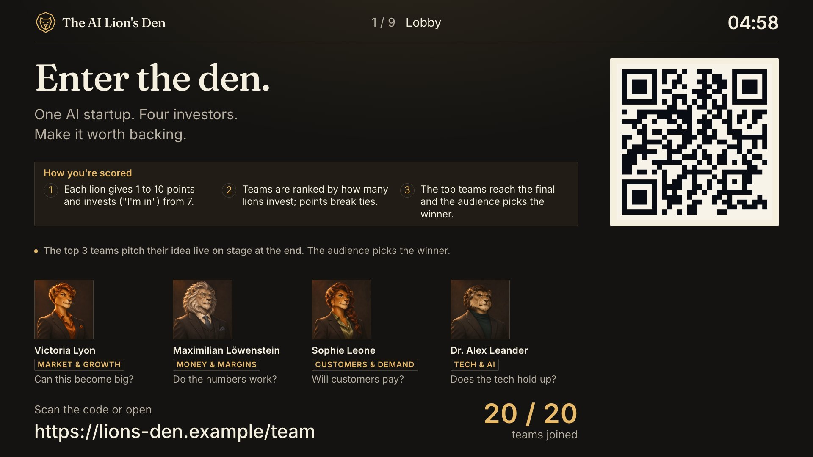 | 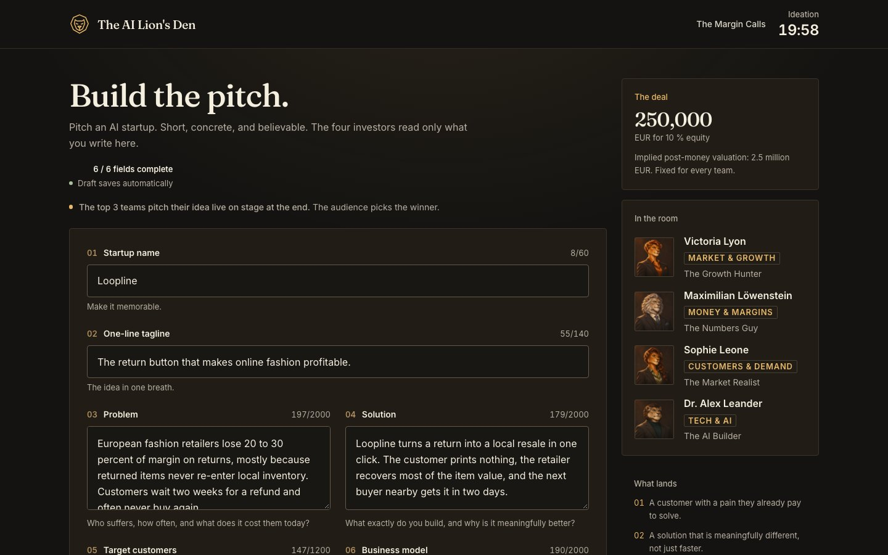 |

| Four AI investors judge every pitch | Teams answer the jury's questions |
|---|---|
| 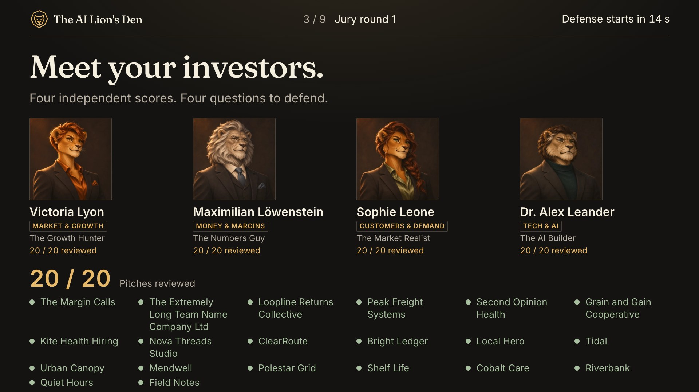 | 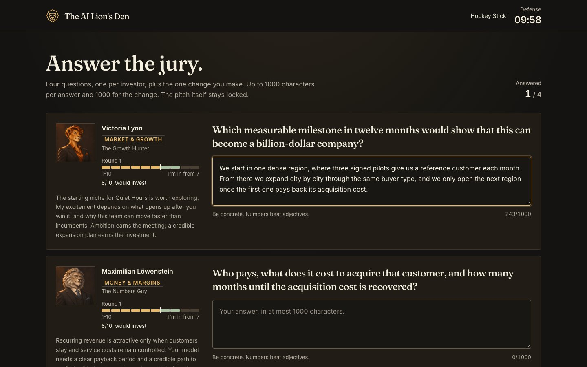 |

| The final verdict shows how scores moved | The three finalists take the stage |
|---|---|
| 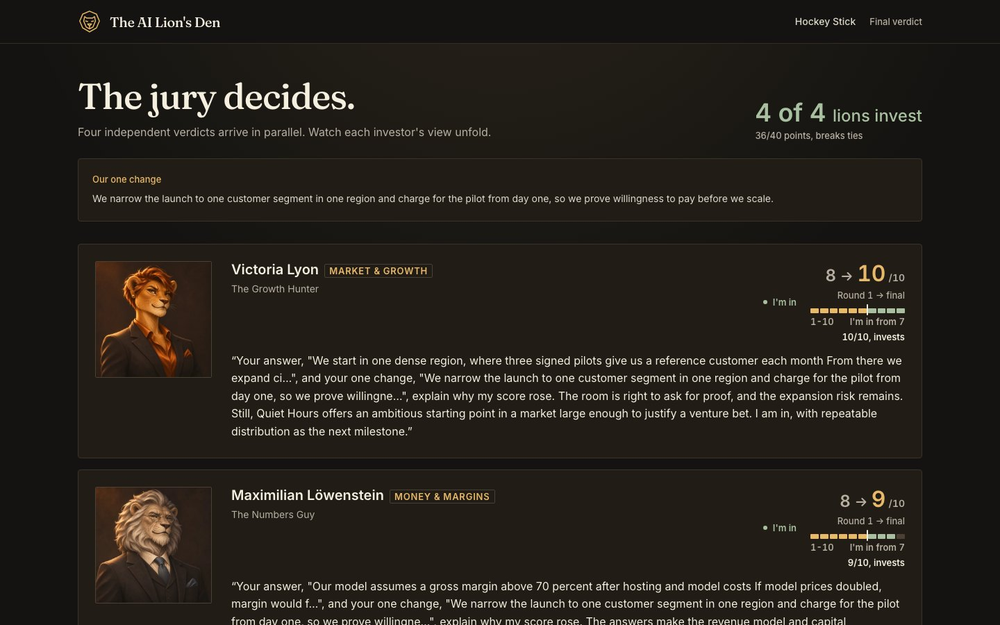 | 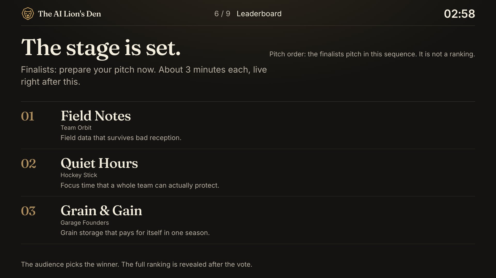 |

| The finalists pitch live | The winner is revealed |
|---|---|
| 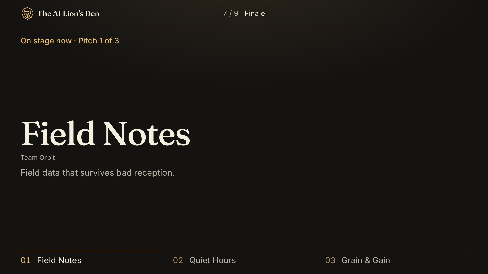 | 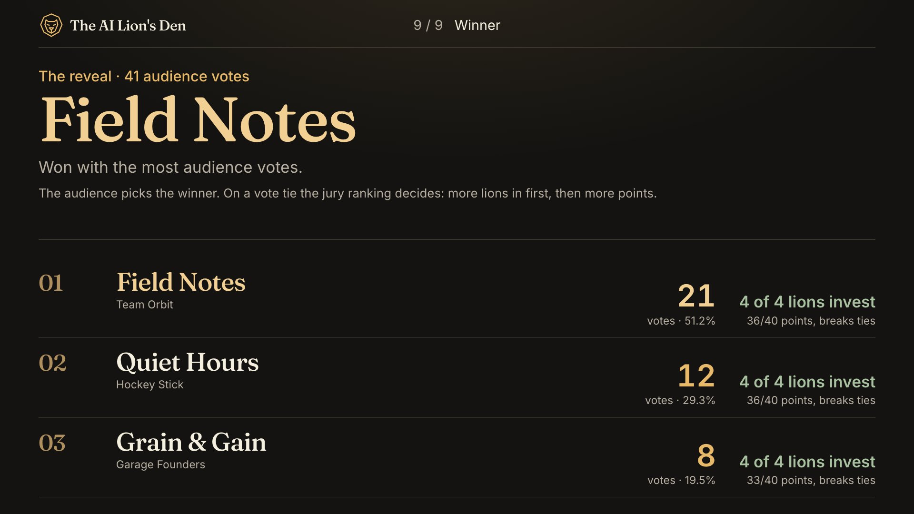 |

| The audience votes on their phones | One vote per phone | Everyone sees the result |
|---|---|---|
| 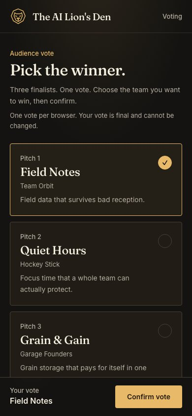 | 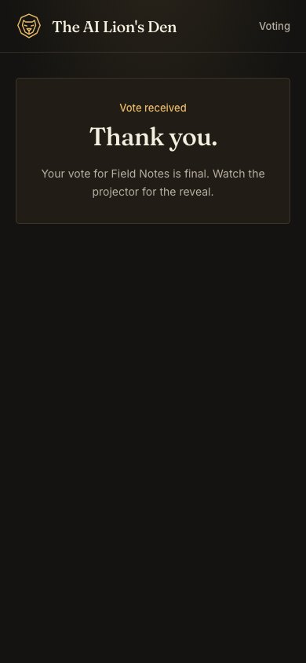 | 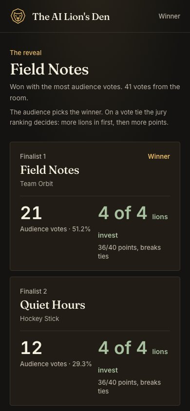 |

More screens, including the moderator view, are in [docs/screenshots](docs/screenshots/README.md).

## How a session runs

Everyone uses the same server; each role opens its own page.

| Screen | Who uses it | Address |
|---|---|---|
| Projector view | The room, on the projector | `/screen` |
| Team view | One laptop per team | `/team` (also `/`) |
| Vote view | Everyone in the audience, on a phone | `/vote` |
| Moderator view | The moderator, password protected | `/moderator` |

Teams join by scanning the QR code on the projector and choosing a team name. There are no
accounts. Teams develop their idea with their own AI assistant (any subscription or a free
one); the app itself has no chat. The moderator advances the session through nine phases,
and every screen follows along.

The default agenda takes about one hour:

| Phase | Default time | What happens |
|---|---|---|
| Lobby | 5 min | The moderator explains the rules while teams join |
| Ideation | 20 min | Teams develop an AI startup and fill in a six-field pitch |
| Jury round 1 | 5 min | Four AI investors score each pitch independently and each asks one critical question |
| Defense | 10 min | Teams answer the four questions and state one concrete change |
| Final verdict | 5 min | Each investor gives a final score and decides "I'm in" (7 or higher) or "I'm out" |
| Leaderboard | 3 min | The three finalists are named in a random pitch order and prepare |
| Finale | untimed | The finalists pitch live, about 3 minutes each |
| Voting | 3 min | The audience votes for one finalist on their phones |
| Winner | untimed | The audience result and the jury result are revealed together |

The scoring rules fit in three lines, shown in the lobby: each lion gives 1 to 10 points and
invests from 7; teams are ranked by how many lions invest, and points break ties; the top
three reach the final and the audience picks the winner. The jury figures stay hidden from
the public screens until the reveal, so the audience votes on the live pitches.

Countdowns guide the room; a phase ends only when the moderator advances it. The one
exception is jury round 1, which moves on to the defense by itself 15 seconds after every
result is in. The full rules are in [docs/concept.md](docs/concept.md).

## The jury

The jury is four fictional investor characters, each with one lens:

| Investor | Focus | Asks about |
|---|---|---|
| Victoria Lyon, The Growth Hunter | Market & Growth | Market size, growth path and scalability |
| Maximilian Löwenstein, The Numbers Guy | Money & Margins | Pricing, unit economics and financial viability |
| Sophie Leone, The Market Realist | Customers & Demand | The buyer, the pain and the willingness to pay |
| Dr. Alex Leander, The AI Builder | Tech & AI | Feasibility, data, defensibility, and whether AI is the core of the product |

Each investor works independently in both rounds and never sees another investor's score,
assessment, question or statement. The rubric judges how well-reasoned and concrete an idea
is; it does not expect real customers or traction, so assumptions, estimates and a concrete
plan count as evidence. A strong AI idea with a weak business is a weak pitch. Team text is
always passed to the model as delimited material, never as instructions.

The personas live in [`backend/personas.py`](backend/personas.py) and the prompts in
[`backend/jury/prompts.py`](backend/jury/prompts.py). The portraits in `public/investors/`
are illustrated lion characters made for this project; they show no real person.

## Quick start

Requirements: [uv](https://docs.astral.sh/uv/) with Python 3.12, and Node.js 22.13 or newer
to build the user interface.

```bash
uv sync
cp .env.example .env
npm ci
npm run build
uv run ai-lions-den
```

Open <http://localhost:3000>. The example configuration runs in **demo mode**: the jury
returns prepared, persona-consistent responses with realistic delays, without any network
request, API key or cost. A whole session can be tried and rehearsed this way.

- Team view: <http://localhost:3000/team>
- Projector view: <http://localhost:3000/screen>
- Vote view: <http://localhost:3000/vote>
- Moderator view: <http://localhost:3000/moderator> (password from `.env`, `change-me` in
  the example)

To try it alone, open the projector and moderator views in two windows and join a few teams
from private browser windows.

The backend is Python (FastAPI). The React user interface is built once into static files
in `out/`, which the Python server serves, so the whole app runs as one process. Node.js is
only needed for the build.

## Using a real model

Demo mode is on when `DEMO_MODE=true` or when `OPENAI_API_KEY` is empty. For a real jury, set
in `.env`:

```bash
DEMO_MODE=false
OPENAI_API_KEY=sk-...
OPENAI_MODEL=gpt-4.1-mini
```

For Azure OpenAI or another OpenAI-compatible endpoint, point `OPENAI_BASE_URL` at its v1
API; no code change is needed:

```bash
DEMO_MODE=false
OPENAI_API_KEY=<azure-openai-key>
OPENAI_BASE_URL=https://<your-resource>.openai.azure.com/openai/v1/
OPENAI_MODEL=<your-deployment-name>
```

The model must support structured outputs (`response_format` with a JSON schema). If a model
rejects `temperature`, the app retries without it. The key is only read on the server and
never reaches the browser. A full session with 20 teams makes 160 jury calls.

## Configuration

| Variable | Purpose | Default |
|---|---|---|
| `DEMO_MODE` | Force the prepared demo jury | `true` when no key is configured |
| `OPENAI_API_KEY` | Server-side API key | empty |
| `OPENAI_BASE_URL` | OpenAI-compatible base URL, including the v1 path | OpenAI default |
| `OPENAI_MODEL` | Model name or Azure deployment name | `gpt-4.1-mini` |
| `JURY_TEMPERATURE` | Sampling temperature; leave empty to omit it | `0.4` |
| `JURY_TIMEOUT_MS` | Timeout per model call | `60000` |
| `JURY_MAX_CONCURRENCY` | Maximum simultaneous model calls | `8` |
| `JURY_AUTO_ADVANCE_SECONDS` | Countdown before jury round 1 advances to the defense once every result is in; `0` turns it off | `15` |
| `DEMO_DELAY_MS` | Base delay for prepared demo responses | `2200` |
| `MODERATOR_PASSWORD` | Password for `/moderator` | `moderator` in development, required in production |
| `PUBLIC_BASE_URL` | Public URL used for the join and vote links and their QR codes | request origin |
| `JOIN_SHORT_URL` | Optional short link (an http(s) URL) shown on the projector instead of the long join link; the QR code still encodes the real join URL. Invalid values are ignored | unset |
| `SESSION_DB` | SQLite file for live state, votes and archived runs | `./data/session.db` |
| `HOST`, `PORT` | Bind address of `uv run ai-lions-den` | `0.0.0.0`, `3000` |

Variables are read from the environment, `.env` and `.env.local` (which overrides `.env`).

## Running a session

1. Put the projector view on the projector and open the moderator view on the moderator's
   laptop. Teams scan the QR code and join; registration stays open through ideation.
2. Advance to **Ideation**. Teams have 20 minutes to develop their AI startup and fill in the
   pitch; the form saves drafts automatically. Only submitted, complete pitches are evaluated.
3. Advance to **Jury round 1**. The pitches lock and the four investors evaluate every pitch.
   When every result is in, the projector shows "Defense starts in 15 s"; **Hold** keeps the
   session in the jury round and **Start now** advances at once. A failed call blocks the
   countdown until you retry it.
4. In the **Defense**, teams see their four scores, assessments and questions, answer each
   question (up to 1000 characters) and state **Our one change**.
5. In the **Final verdict**, each investor rescores within two points of their round 1 score.
   Every score shows a 1 to 10 scale with the "I'm in" line at 7 and its movement, for
   example "5 -> 7".
6. The **Leaderboard** is the finalists' preparation time. The projector names the three
   finalists in a random, fixed pitch order, without jury figures.
7. In the **Finale**, use **Previous finalist** and **Next finalist** to move the projector
   spotlight to the team on stage. **Start pitch clock** starts a 3-minute orientation clock
   in the moderator view and in the finalist's team view; it never ends the phase.
8. Advance to **Voting**. The projector shows the vote QR code and the number of votes cast.
   One browser gets one vote.
9. Advance to **Winner** to close voting and reveal the audience result next to the jury
   result. An audience tie goes to the better jury ranking.

If you advance by mistake, **Back to** steps one phase back without losing any data. If a
jury call fails, the moderator view shows the error and a retry button for that team; other
teams are unaffected.

**Reset session** archives the run under **Past runs** and returns to an empty lobby. The
moderator can download the current or any archived run as JSON or CSV, open an archived run
read-only, or delete it.

## Deployment

The repository contains a multi-stage `Dockerfile` that builds the user interface and runs
the server with Python 3.12 and only the production dependencies. The image runs as a
non-root user, listens on port 3000 and serves a health check at `/api/health`. Build it
yourself from the repository root:

```bash
docker build -t ai-lions-den .
```

The app keeps its state in one process and one SQLite file, so always run **exactly one
instance** and put `SESSION_DB` on persistent storage.

### Any container host

```bash
docker run -d --name ai-lions-den -p 3000:3000 \
  -v ai-lions-den-data:/home/data \
  -e SESSION_DB=/home/data/session.db \
  -e MODERATOR_PASSWORD='<long-random-secret>' \
  -e PUBLIC_BASE_URL=https://<your-host> \
  ai-lions-den
```

This starts in demo mode. Add `-e DEMO_MODE=false -e OPENAI_API_KEY=... -e OPENAI_MODEL=...`
(and `OPENAI_BASE_URL` if needed) for the real jury. Serve it over HTTPS behind a reverse
proxy, and set `PUBLIC_BASE_URL` to the address the room will open, because the QR codes
point there.

### Azure App Service

[docs/deploy-azure.md](docs/deploy-azure.md) is a step-by-step checklist for Azure App
Service (Web App for Containers): first deployment, app settings, updates, pausing between
events and troubleshooting.

## Development

```bash
uv sync
npm ci
npm run typecheck                         # TypeScript check without building
npm run build                             # static UI export to out/
uv run pytest                             # Python test suite
uv run ruff check backend scripts tests
uv run ruff format --check backend scripts tests
uv run python scripts/e2e_demo.py         # full 20-team demo session over HTTP
```

The test suite covers the ranking and tie-breaks, the audience vote, phase transitions and
pitch locking, jury orchestration, retries and fault injection, prompt independence,
persistence across restarts, and one complete session with several clients polling the same
server (`tests/test_session_flow.py`). The end-to-end script starts a production server in
demo mode, plays a full session with 20 teams and 60 concurrent voters, and measures page
responsiveness while the jury works.

The viewport layout check drives a demo session through every phase at projector, laptop,
phone and moderator sizes and asserts layout invariants instead of golden images:

```bash
npm run build
uv run playwright install chromium
RUN_LAYOUT_CHECK=1 uv run pytest tests/test_viewport_layout.py -q
```

`uv run python scripts/capture_layout.py --out <dir>` captures the full viewport matrix for
manual review, and `scripts/load_test.py` load-tests a running demo-mode instance (it refuses
to run against a real jury). GitHub Actions runs lint, tests, the type check, the build, the
layout check and the end-to-end session on every pull request.

### Jury benchmarks

Two optional, paid benchmarks measure the jury's quality with a real model. Neither runs in
the test suite.

- The **lion quality benchmark** runs the real jury code path over nine fixed pitches of
  known quality and scores the output deterministically: discrimination between strong and
  weak pitches, the effect of a good or evasive defense, consistency, lens adherence,
  faithfulness and resistance to prompt injection. A full run costs about 0.86 USD with
  `gpt-4.1-mini`, with a 4 USD hard cap. See [docs/lion-benchmark.md](docs/lion-benchmark.md).

  ```bash
  uv run python -m backend.benchmark --confirm
  ```

- The **live lion benchmark** plays one scripted session against a deployed instance over
  its HTTP API. It replaces the current session on the target, so never run it during an
  event. See [docs/live-benchmark.md](docs/live-benchmark.md).

### Project layout

- `backend/`: the Python backend; start at `backend/main.py`.
- `backend/personas.py` and `backend/jury/`: the investor personas, prompts, model and demo
  providers, output validation and orchestration.
- `backend/benchmark/`, `backend/live_benchmark/`, `benchmarks/`: the jury benchmarks and
  their test set.
- `app/`, `components/`, `lib/`: the React user interface.
- `tests/`: the pytest suite. `scripts/`: the end-to-end, layout and load test scripts.
- `docs/`: the concept, the benchmark guides, the Azure guide and the screenshots.

The phase list and pitch field limits are duplicated as presentation constants in
`lib/session-state.ts` and `lib/pitch.ts`; the server enforces the real rules in
`backend/state.py` and `backend/pitch.py`.

## Data and privacy

The app stores team names, pitches, defense answers, the generated jury output and one
anonymous random voter id per browser, all in one SQLite file. It collects no accounts,
emails or other personal data. Past runs stay in the same file until they are deleted; to
remove everything, stop the app and delete the database file after the event. With a real
model, team text is sent to the configured model provider.

## Design notes

- Live updates use simple polling every 1.2 to 2 seconds; no websockets are needed at this
  scale (up to 20 teams and a room of voters).
- Jury calls run as background work, limited by `JURY_MAX_CONCURRENCY`, so page requests
  never wait for a model.
- Final scores are clamped to within two points of each investor's round 1 score, and the
  "I'm in" decision is derived from the score on the server, so the two always agree.

## Background

The AI Lion's Den was first built for a live startup pitch event and is published here as a
standalone project.

## License

[MIT](LICENSE)

Fonts: Inter and Fraunces, SIL Open Font License 1.1.
